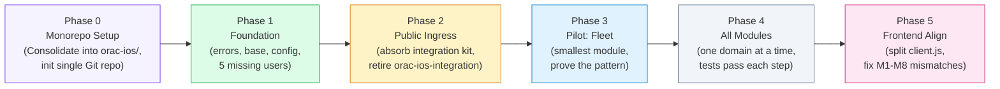

# ORAC ERP — LOCKED FULL-STACK ARCHITECTURE (v2.0)

> **Status:** ✅ APPROVED BLUEPRINT — Build from this, do not deviate.
> **Date Locked:** 18 November 2026
> **Updated:** 18 November 2026 — Unified Monorepo Root approved by Brian
> **Authors:** Brian Lupao (System Owner) + Antigravity (Engineering Agent)
> **Rule:** No structural changes without Brian's written approval.

---

## PART 0: UNIFIED MONOREPO ROOT

> [!IMPORTANT]
> **Decision D18 (Agreed 18 Nov 2026, Corrected 19 Nov 2026):**
> 1. **ORAC Operations Monorepo (`orac-ios/`):** Consolidates the **TWO** operational repositories (`orac-backend` + `orac-ios-frontend`) into ONE Git repository. Backend deploys to **Fly.io**, Operations/Client Portal deploys to **Render**.
> 2. **Public Website (`orac-systems-demo`):** Stays in its **SEPARATE** repository (`https://github.com/brianlupao123/Orac-system-web.git`) and is deployed to **Vercel** (`https://orac-system-web.vercel.app`). It is **NOT** bundled inside `orac-ios/`. Its backend relies entirely on `orac-backend` on Fly.io via HTTP ingress (`POST /api/leads`, `POST /api/public/enquiries`).
> 3. **NO WordPress is used.** Both the public marketing website (`orac-systems-demo` on Vercel) and the operations portal (`orac-ios-frontend` on Render) are 100% modern React applications.

```
orac-ios/                                  # ═══ SINGLE GIT REPOSITORY ═══
│
├── .git/                                  # ONE repo, ONE history, ONE audit trail
├── .gitignore                             # Ignores node_modules, .env, dist, uploads
├── .github/
│   ├── CODEOWNERS                         # Per-directory review rules
│   └── workflows/
│       ├── backend-ci.yml                 # Triggers on orac-backend/** changes
│       └── frontend-ci.yml               # Triggers on orac-ios-frontend/** changes
│
├── orac-backend/                          # ═══ PART 1: BACKEND (see below) ═══
│   ├── src/
│   ├── tests/
│   ├── docs/
│   ├── scripts/
│   ├── .env.example
│   ├── package.json
│   ├── Dockerfile
│   └── README.md
│
├── orac-ios-frontend/                     # ═══ PART 2: FRONTEND (see below) ═══
│   ├── src/
│   ├── public/
│   ├── index.html
│   ├── vite.config.js
│   ├── tailwind.config.js
│   ├── package.json
│   └── .env
│
├── docs/                                  # ═══ ROOT-LEVEL SYSTEM DOCUMENTATION ═══
│   ├── MASTER_MEMORY.md                   # Single source of truth (37 configs, 13 roles)
│   ├── ARCHITECTURE.md                    # This document (deployed copy)
│   ├── API_CONTRACTS.md                   # REST endpoint specs & payload schemas
│   └── DEPLOYMENT.md                      # Fly.io + Neon deployment guide
│
├── docker-compose.yml                     # One-command dev: Postgres + Backend + Frontend
└── README.md                              # Master repo onboarding guide
```

### Why Monorepo (Decision Record)

| Concern | Monorepo Advantage |
|---------|-------------------|
| **Atomic commits** | Backend API + Frontend UI for a feature land in one PR |
| **Shared contracts** | API shape changes break frontend tests in the same CI run |
| **Single audit trail** | One `git log` reconstructs full feature history |
| **One security boundary** | One CODEOWNERS, one set of branch protections |
| **One-command dev** | `docker-compose up` boots Postgres + API + UI |
| **Simpler CI/CD** | Path-filtered workflows; no cross-repo webhooks |

### System Topology & Deployment Architecture

```
  ┌─────────────────────────────────────────┐               ┌─────────────────────────────────────────┐
  │      Public Marketing Website           │               │       Internal Operations Portal        │
  │         (orac-systems-demo)             │               │           (orac-ios-frontend)           │
  │                                         │               │                                         │
  │  • Repo: brianlupao123/Orac-system-web  │               │  • Repo: orac-ios (Monorepo sibling)    │
  │  • Hosting: Vercel (Public Domain)      │               │  • Hosting: Render                      │
  │  • Pages: Home, About, Services,        │               │  • Workspaces: Dispatch, Timesheets,    │
  │    Industries, News, Projects, Contact, │               │    Invoicing, Fleet, HSE, Artisan Vault,│
  │    Quote Drawer, Survey Booking, Chat   │               │    Procurement, Client Portal, Admin    │
  └────────────────────┬────────────────────┘               └────────────────────┬────────────────────┘
                       │                                                         │
                       │ Public Ingress (HTTP)                                   │ JWT Authenticated (HTTP)
                       │ POST /api/leads                                         │ /api/* (14 Feature Slices)
                       │ POST /api/public/enquiries                              │
                       │                                                         │
                       ▼                                                         ▼
  ┌───────────────────────────────────────────────────────────────────────────────────────────────────┐
  │                                   orac-backend (Express ESM API)                                  │
  │                                • Repo: orac-ios (Monorepo sibling)                                │
  │                                • Hosting: Fly.io (Johannesburg jnb region)                        │
  │                                • Port: 5050 (Fly.io internal 5000/8080)                           │
  │                                • Database: PostgreSQL (Neon Cloud) / In-memory JSON               │
  │                                • Modules: 20 Domain Modules + Public Ingress Gateway              │
  └───────────────────────────────────────────────────────────────────────────────────────────────────┘
```

---

## PART 1: BACKEND ARCHITECTURE

```
orac-backend/
│
├── src/
│   │
│   ├── app.js                              # Express app factory (no server.listen)
│   ├── server.js                           # Entry: creates app, binds port, graceful shutdown
│   ├── router.js                           # Root router: mounts module routers (< 30 lines)
│   │
│   ├── config/                             # ═══ ALL CONFIGURATION (37 items) ═══
│   │   ├── index.js                        # Central config loader (env → typed object)
│   │   ├── database.js                     # DB connection (pool, TLS, timeouts)
│   │   ├── auth.js                         # JWT secrets, OAuth client IDs, session config
│   │   ├── upload.js                       # File upload limits, storage paths
│   │   ├── email.js                        # SMTP config (dormant until S-03 auth)
│   │   └── constants.js                    # Business: currency=USD, timezone=Africa/Harare
│   │
│   ├── middleware/                         # ═══ SHARED MIDDLEWARE STACK ═══
│   │   ├── authenticate.js                # JWT/session verification → req.user
│   │   ├── authorize.js                   # Role-based access control (RBAC) guard
│   │   ├── validate.js                    # Zod schema validation (generic)
│   │   ├── rateLimiter.js                 # Brute-force protection (existing)
│   │   ├── publicRateLimit.js             # Pre-persistence limiter (FROM integration kit)
│   │   ├── securityHeaders.js             # Helmet-style headers
│   │   ├── requestLogger.js               # Structured JSON request logging
│   │   ├── errorHandler.js                # Global error → JSON response mapper
│   │   ├── idempotency.js                 # Idempotency key deduplication
│   │   ├── audit.js                       # Auto-append to audit_logs on mutation
│   │   ├── pagination.js                  # Parse ?page=&limit= → req.pagination
│   │   └── cors.js                        # CORS configuration
│   │
│   ├── modules/                           # ═══ 14 AUTONOMOUS DOMAIN MODULES ═══
│   │   │
│   │   │  ┌──────────────────────────────────────────────────────────────┐
│   │   │  │  EACH MODULE HAS THIS INTERNAL STRUCTURE:                   │
│   │   │  │                                                              │
│   │   │  │  module-name/                                                │
│   │   │  │  ├── routes.js          Express.Router() — only this module │
│   │   │  │  ├── controllers/       HTTP ↔ Service bridge (thin)        │
│   │   │  │  ├── services/          Pure business logic (no req/res)    │
│   │   │  │  ├── models/            Data shape, defaults, computed      │
│   │   │  │  ├── schemas/           Zod input validation                │
│   │   │  │  ├── constants.js       Module-specific enums & thresholds  │
│   │   │  │  ├── index.js           Barrel export                       │
│   │   │  │  └── __tests__/         Isolated module tests               │
│   │   │  └──────────────────────────────────────────────────────────────┘
│   │   │
│   │   ├── commercial/                # §1 COMMERCIAL & CONTRACTS
│   │   │   ├── routes.js
│   │   │   ├── controllers/
│   │   │   │   ├── quoteController.js
│   │   │   │   ├── coreController.js           # Leads CRUD (createLead)
│   │   │   │   ├── jobTrackerController.js
│   │   │   │   ├── contractsController.js
│   │   │   │   ├── salesPortfolioController.js
│   │   │   │   └── serviceRequestsController.js
│   │   │   ├── services/
│   │   │   │   ├── quoteCalculation.js
│   │   │   │   ├── clientPrService.js
│   │   │   │   ├── stateMachine.js             # Quote state transitions
│   │   │   │   ├── serviceRequestRules.js
│   │   │   │   ├── invoiceReadiness.js
│   │   │   │   └── v5CommercialWorkflow.js
│   │   │   ├── models/
│   │   │   │   ├── Quote.js
│   │   │   │   ├── Lead.js
│   │   │   │   ├── PurchaseOrder.js
│   │   │   │   └── Contract.js
│   │   │   ├── schemas/
│   │   │   │   ├── quoteSchemas.js             # CreateQuoteSchema, TransitionQuoteSchema
│   │   │   │   ├── leadSchemas.js              # CreateLeadSchema
│   │   │   │   └── contractSchemas.js
│   │   │   ├── constants.js                    # 14 job statuses, quote states
│   │   │   ├── index.js
│   │   │   └── __tests__/
│   │   │       ├── quote.test.js
│   │   │       ├── stateMachine.test.js
│   │   │       └── jobTracker.test.js
│   │   │
│   │   ├── operations/                # §2 OPERATIONS & JOB CONTROLS
│   │   │   ├── routes.js
│   │   │   ├── controllers/
│   │   │   │   ├── dispatchController.js
│   │   │   │   ├── worksheetRegisterController.js
│   │   │   │   ├── dailyTimesheetController.js
│   │   │   │   ├── timesheetWorkflowController.js
│   │   │   │   ├── timesheetReviewController.js
│   │   │   │   ├── timesheetAcknowledgementController.js
│   │   │   │   ├── kioskController.js
│   │   │   │   ├── ganttSchedulingController.js
│   │   │   │   └── contractorLogController.js
│   │   │   ├── services/
│   │   │   │   ├── dispatchService.js
│   │   │   │   ├── ganttSchedulingService.js
│   │   │   │   ├── worksheetService.js
│   │   │   │   └── rosterService.js
│   │   │   ├── models/
│   │   │   │   ├── DispatchCard.js
│   │   │   │   ├── Timesheet.js
│   │   │   │   └── Worksheet.js
│   │   │   ├── schemas/
│   │   │   │   ├── dispatchSchemas.js
│   │   │   │   ├── timesheetSchemas.js         # Absorbs timesheetSchemasV2.js
│   │   │   │   └── worksheetSchemas.js         # Absorbs worksheetRegisterSchemas.js
│   │   │   ├── constants.js                    # Dispatch statuses, timesheet types, trade categories
│   │   │   ├── index.js
│   │   │   └── __tests__/
│   │   │       ├── dispatch.test.js
│   │   │       ├── timesheet.test.js
│   │   │       └── worksheet.test.js
│   │   │
│   │   ├── procurement/               # §3 PROCUREMENT & STORES
│   │   │   ├── routes.js
│   │   │   ├── controllers/
│   │   │   │   ├── procurementController.js
│   │   │   │   ├── inventoryController.js
│   │   │   │   ├── reorderAlertController.js
│   │   │   │   └── operationalDataController.js
│   │   │   ├── services/
│   │   │   │   ├── inventoryLedger.js          # ★ THE SINGLE SOURCE OF STOCK TRUTH ★
│   │   │   │   ├── threeWayMatchingService.js
│   │   │   │   ├── reorderAlertService.js
│   │   │   │   └── masterDataService.js
│   │   │   ├── models/
│   │   │   │   ├── StockItem.js
│   │   │   │   ├── PurchaseRequisition.js
│   │   │   │   ├── SupplierPo.js
│   │   │   │   ├── Grn.js
│   │   │   │   └── StoreIssueVoucher.js
│   │   │   ├── schemas/
│   │   │   │   └── procurementSchemas.js
│   │   │   ├── constants.js                    # PR approval threshold ($500), variance tolerance (5%)
│   │   │   ├── index.js
│   │   │   └── __tests__/
│   │   │
│   │   ├── fleet/                     # §4 FLEET & FACILITIES
│   │   │   ├── routes.js
│   │   │   ├── controllers/
│   │   │   │   ├── vehicleController.js
│   │   │   │   ├── odometerController.js
│   │   │   │   ├── complianceController.js     # COF, ZINARA, VID, Insurance
│   │   │   │   └── maintenanceController.js
│   │   │   ├── services/
│   │   │   │   ├── vehicleService.js
│   │   │   │   └── fleetComplianceService.js
│   │   │   ├── models/
│   │   │   │   ├── Vehicle.js
│   │   │   │   ├── OdometerReading.js
│   │   │   │   └── MaintenanceRequest.js
│   │   │   ├── schemas/
│   │   │   │   └── fleetSchemas.js
│   │   │   ├── constants.js                    # Fuel threshold (14.0 L/100km)
│   │   │   ├── index.js
│   │   │   └── __tests__/
│   │   │
│   │   ├── hse/                       # §5 HEALTH, SAFETY, ENVIRONMENT & QUALITY
│   │   │   ├── routes.js
│   │   │   ├── controllers/
│   │   │   │   ├── jsaController.js            # Job Safety Analysis (5×5 risk matrix)
│   │   │   │   ├── ppeController.js
│   │   │   │   ├── incidentController.js
│   │   │   │   └── inspectionController.js
│   │   │   ├── services/
│   │   │   │   ├── jsaService.js
│   │   │   │   ├── hseQualityService.js
│   │   │   │   └── inspectionService.js
│   │   │   ├── models/
│   │   │   │   ├── Jsa.js                      # Hazard steps, risk scoring, PPE requirements
│   │   │   │   ├── Inspection.js
│   │   │   │   └── Incident.js
│   │   │   ├── schemas/
│   │   │   │   └── hseSchemas.js
│   │   │   ├── constants.js                    # Risk levels, ISO 9001 inspection verdicts
│   │   │   ├── index.js
│   │   │   └── __tests__/
│   │   │
│   │   ├── hr/                        # §6 HR & PEOPLE
│   │   │   ├── routes.js
│   │   │   ├── controllers/
│   │   │   │   ├── technicianController.js
│   │   │   │   ├── artisanDocController.js
│   │   │   │   ├── leaveController.js
│   │   │   │   ├── payrollController.js
│   │   │   │   └── registrationController.js
│   │   │   ├── services/
│   │   │   │   ├── leaveService.js
│   │   │   │   ├── artisanDocumentService.js
│   │   │   │   ├── expiryWatcherService.js     # 90/60/30-day cert expiry alerts
│   │   │   │   └── payrollService.js
│   │   │   ├── models/
│   │   │   │   ├── Technician.js
│   │   │   │   ├── LeaveRequest.js
│   │   │   │   ├── ArtisanDocument.js
│   │   │   │   └── Qualification.js
│   │   │   ├── schemas/
│   │   │   │   ├── artisanSchemas.js
│   │   │   │   └── leaveSchemas.js
│   │   │   ├── constants.js                    # Leave types (Zimbabwe Labour Act), doc types
│   │   │   ├── index.js
│   │   │   └── __tests__/
│   │   │
│   │   ├── finance/                   # §7 FINANCE & ACCOUNTS
│   │   │   ├── routes.js
│   │   │   ├── controllers/
│   │   │   │   ├── invoiceSettlementController.js
│   │   │   │   ├── legacyInvoiceDraftController.js
│   │   │   │   ├── reportsController.js
│   │   │   │   ├── documentController.js       # PDF generation (zero external deps)
│   │   │   │   └── pastelExportController.js
│   │   │   ├── services/
│   │   │   │   ├── invoiceReadiness.js
│   │   │   │   ├── invoiceSettlement.js
│   │   │   │   ├── pdfGenerator.js             # Authoritative PDF engine
│   │   │   │   ├── pdfEncryption.js            # PDF password protection (S-13)
│   │   │   │   ├── exporter.js                 # CSV/Excel export engine
│   │   │   │   └── pastelCsvService.js         # Pastel Partner GL format (VAT code 01)
│   │   │   ├── models/
│   │   │   │   ├── Invoice.js
│   │   │   │   ├── Payment.js
│   │   │   │   └── CreditNote.js
│   │   │   ├── schemas/
│   │   │   │   └── financeSchemas.js
│   │   │   ├── constants.js                    # USD-only (S-08), payment terms, Pastel GL codes
│   │   │   ├── index.js
│   │   │   └── __tests__/
│   │   │
│   │   ├── admin/                     # §8 SYSTEM ADMINISTRATION
│   │   │   ├── routes.js              # Includes PUBLIC routes: /auth/login, /access-requests
│   │   │   ├── controllers/
│   │   │   │   ├── authController.js
│   │   │   │   ├── totpController.js
│   │   │   │   ├── adminController.js
│   │   │   │   ├── accessRequestsController.js
│   │   │   │   ├── makerCheckerController.js
│   │   │   │   └── importController.js
│   │   │   ├── services/
│   │   │   │   ├── authService.js
│   │   │   │   ├── googleOAuthService.js
│   │   │   │   ├── makerCheckerService.js
│   │   │   │   └── masterDataService.js
│   │   │   ├── models/
│   │   │   │   ├── User.js
│   │   │   │   ├── Role.js
│   │   │   │   └── AuditLog.js
│   │   │   ├── schemas/
│   │   │   │   ├── authSchemas.js
│   │   │   │   └── adminSchemas.js
│   │   │   ├── constants.js                    # 13 roles, permissions matrix
│   │   │   ├── index.js
│   │   │   └── __tests__/
│   │   │
│   │   ├── communications/           # §9 EMAIL & NOTIFICATIONS
│   │   │   ├── routes.js
│   │   │   ├── controllers/
│   │   │   │   ├── communicationsController.js
│   │   │   │   └── notificationController.js
│   │   │   ├── services/
│   │   │   │   ├── communicationQueueService.js
│   │   │   │   ├── communicationTemplateService.js
│   │   │   │   ├── communicationAuditService.js
│   │   │   │   └── structuredLoggingService.js
│   │   │   ├── templates/                      # Email templates (Handlebars/EJS)
│   │   │   ├── models/
│   │   │   │   └── Notification.js
│   │   │   ├── schemas/
│   │   │   ├── index.js
│   │   │   └── __tests__/
│   │   │
│   │   ├── surveys/                   # §10 VIRTUAL SURVEYS & AI MINUTES
│   │   │   ├── routes.js
│   │   │   ├── controllers/
│   │   │   │   └── surveyController.js
│   │   │   ├── services/
│   │   │   │   ├── videoMeetingService.js      # Daily.co room provisioning
│   │   │   │   └── meetingAiService.js         # Claude transcription & extraction
│   │   │   ├── models/
│   │   │   │   ├── SurveySession.js
│   │   │   │   └── MeetingMinutes.js
│   │   │   ├── schemas/
│   │   │   ├── index.js
│   │   │   └── __tests__/
│   │   │
│   │   ├── feedback/                  # §11 CLIENT FEEDBACK & NPS
│   │   │   ├── routes.js
│   │   │   ├── controllers/
│   │   │   │   └── feedbackController.js
│   │   │   ├── services/
│   │   │   │   └── qbrReportService.js
│   │   │   ├── models/
│   │   │   │   └── FeedbackRecord.js
│   │   │   ├── schemas/
│   │   │   ├── index.js
│   │   │   └── __tests__/
│   │   │
│   │   ├── iot/                       # §12 IoT TELEMETRY & OFFLINE SYNC
│   │   │   ├── routes.js
│   │   │   ├── controllers/
│   │   │   │   ├── telemetryController.js
│   │   │   │   └── syncController.js
│   │   │   ├── services/
│   │   │   │   ├── iotTelemetryService.js
│   │   │   │   └── offlineSyncService.js
│   │   │   ├── models/
│   │   │   │   └── TelemetryReading.js
│   │   │   ├── schemas/
│   │   │   ├── index.js
│   │   │   └── __tests__/
│   │   │
│   │   ├── uploads/                   # §13 FILE UPLOAD & DOCUMENT VAULT
│   │   │   ├── routes.js
│   │   │   ├── controllers/
│   │   │   │   └── fileUploadController.js
│   │   │   ├── services/
│   │   │   │   └── fileUploadService.js
│   │   │   ├── models/
│   │   │   │   └── DocumentRecord.js
│   │   │   ├── schemas/
│   │   │   ├── index.js
│   │   │   └── __tests__/
│   │   │
│   │   └── public/                    # §14 PUBLIC WEB INGRESS (FROM INTEGRATION KIT)
│   │       ├── routes.js              # /api/v1/public/slots, /api/v1/public/enquiries
│   │       ├── controllers/
│   │       │   └── websiteController.js
│   │       ├── services/
│   │       │   ├── scheduleService.js          # Harare UTC+2 calendar & capacity engine
│   │       │   ├── bookingStateService.js      # Atomic slot mutex (25-way race-safe)
│   │       │   └── leadMapperService.js        # Maps web forms → internal Lead
│   │       ├── schemas/
│   │       │   └── enquirySchema.js            # Public enquiry Zod validation
│   │       ├── index.js
│   │       └── __tests__/
│   │           ├── website-booking.test.js
│   │           ├── website-schedule.test.js
│   │           ├── website-leadMapper.test.js
│   │           ├── website-rateLimit.test.js
│   │           └── website-validateEnquiry.test.js
│   │
│   ├── shared/                        # ═══ CROSS-CUTTING REUSABLE CODE ═══
│   │   ├── errors/
│   │   │   ├── AppError.js            # Base: message, statusCode, isOperational, stack
│   │   │   ├── ValidationError.js     # 400
│   │   │   ├── AuthenticationError.js # 401
│   │   │   ├── ForbiddenError.js      # 403
│   │   │   ├── NotFoundError.js       # 404 (carries entity + entityId)
│   │   │   ├── ConflictError.js       # 409
│   │   │   ├── BusinessRuleError.js   # 422 (carries details)
│   │   │   └── index.js
│   │   ├── base/
│   │   │   ├── BaseController.js      # wrapAsync, sendSuccess, sendCreated, sendPaginated
│   │   │   ├── BaseService.js         # CRUD using ARRAY methods (.find, .filter, .push)
│   │   │   └── BaseModel.js           # Schema definition, defaults, toJSON
│   │   ├── utils/
│   │   │   ├── dates.js               # CAT time, business days, Zimbabwe holidays
│   │   │   ├── currency.js            # USD formatting, 2-decimal (S-08)
│   │   │   ├── pagination.js          # Page calculations, hasMore
│   │   │   ├── sanitize.js            # XSS strip, filename sanitization
│   │   │   ├── crypto.js              # AES-256 bank encryption, SHA-256 tokens
│   │   │   └── id.js                  # Entity ID generators (lead_*, quote_*, etc.)
│   │   ├── patterns/
│   │   │   ├── stateMachine.js        # Generic finite state machine engine
│   │   │   └── eventBus.js            # In-process pub/sub
│   │   └── types/
│   │       └── common.d.ts            # JSDoc / TS type definitions
│   │
│   ├── database/                      # ═══ DATA LAYER ═══
│   │   ├── store.js                   # In-memory single store (array collections)
│   │   ├── configuredStore.js         # Storage driver router (json vs postgres)
│   │   ├── postgresStore.js           # PostgreSQL adapter
│   │   ├── pool.js                    # pg connection pool + TLS
│   │   ├── persistenceMiddleware.js   # Monolithic lock + read/write cycle
│   │   ├── migrations/
│   │   │   ├── 001_initial.sql
│   │   │   ├── 002_procurement.sql
│   │   │   ├── 003_fleet_hse.sql
│   │   │   ├── 004_artisan.sql
│   │   │   ├── 005_surveys.sql
│   │   │   ├── 006_feedback_qr.sql
│   │   │   └── 007_iot_sync.sql
│   │   └── seeds/
│   │       ├── demo.js                # 13-role demo users + 3 clients + suppliers
│   │       └── test.js                # Minimal fictional test fixtures (.invalid TLD)
│   │
│   ├── integrations/                  # ═══ EXTERNAL SERVICE GATEWAYS ═══
│   │   ├── google/
│   │   │   └── oauthClient.js         # Google token verification
│   │   ├── daily/
│   │   │   └── webrtcGateway.js       # Daily.co video room provisioner
│   │   ├── anthropic/
│   │   │   └── claudeClient.js        # Claude prompt extraction
│   │   ├── pastel/
│   │   │   └── csvFormatter.js        # Pastel Partner GL format (VAT code 01)
│   │   └── sms/
│   │       └── smsGateway.js          # Future: Econet/NetOne SMS
│   │
│   ├── jobs/                          # ═══ BACKGROUND SCHEDULED TASKS ═══
│   │   ├── scheduler.js               # Cron setup (Africa/Harare timezone)
│   │   ├── expiryWatcher.job.js       # Daily 06:00: scan expiring certs/docs
│   │   ├── reorderScanner.job.js      # Daily 07:00: scan low stock
│   │   ├── complianceScanner.job.js   # Weekly Monday 06:00: fleet VID/insurance
│   │   ├── staleAlertCleaner.job.js   # Monthly: archive old dismissed alerts
│   │   └── auditLogArchiver.job.js    # Monthly: archive old audit entries
│   │
│   └── security/                      # ═══ SECURITY CONTROLS ═══
│       ├── encryption.js              # AES-256-GCM for bank details (S-01)
│       ├── pdfEncryption.js           # PDF password protection (S-13)
│       ├── tokenHashing.js            # SHA-256 token digests (S-06)
│       ├── setupTokens.js             # One-time setup links (S-09)
│       └── tripwires.js               # S-03, S-04, S-05, S-08 enforcement
│
├── tests/                             # ═══ TEST INFRASTRUCTURE ═══
│   ├── setup.js                       # Global test setup (env, mocks)
│   ├── helpers/
│   │   ├── testDb.js                  # In-memory DB factory for tests
│   │   ├── testApp.js                 # Express app factory for HTTP tests
│   │   ├── authHelper.js              # Generate test JWT tokens per role
│   │   └── fixtures.js                # Shared test data builders
│   ├── integration/                   # Cross-module integration tests
│   │   ├── quoteToInvoice.test.js     # Full commercial lifecycle
│   │   ├── dispatchToPayroll.test.js  # Operations → HR flow
│   │   └── procurementFlow.test.js    # PR → PO → GRN → SIV → 3-way match
│   ├── guards/                        # Tripwire / safety tests
│   │   ├── noOutboundEmailGuard.test.js
│   │   ├── directSaleSeamGuard.test.js
│   │   ├── normalizeDbProductionGuard.test.js
│   │   └── routeInventory.test.js     # Security guard: auth before protected routes
│   └── e2e/                           # End-to-end scenario tests
│       └── fullJobLifecycle.test.js
│
├── docs/                              # ═══ BACKEND-SPECIFIC DOCS ═══
│   ├── API.md                         # Endpoint reference
│   ├── SUBSYSTEMS.md                  # Subsystem overview map
│   └── openapi.yaml                   # OpenAPI 3.0 spec
│
├── scripts/                           # ═══ DEV & OPS ═══
│   ├── migrate.js                     # Run database migrations
│   ├── seed.js                        # Seed demo/test data
│   ├── healthcheck.js                 # Docker/K8s health probe
│   └── backup.js                      # DB backup script
│
├── .env.example                       # 37-item configuration template
├── package.json                       # 5 deps: bcrypt, express, jsonwebtoken, pg, zod
├── Dockerfile
└── README.md
```

---

## THE ROOT ROUTER (< 30 Lines)

```javascript
// src/router.js — THE ENTIRE FILE
import { Router } from "express";
import { authenticate } from "./middleware/authenticate.js";

// Public module (no auth required)
import publicRoutes from "./modules/public/routes.js";
import adminRoutes from "./modules/admin/routes.js";

// Protected modules (auth required)
import commercialRoutes from "./modules/commercial/routes.js";
import operationsRoutes from "./modules/operations/routes.js";
import procurementRoutes from "./modules/procurement/routes.js";
import fleetRoutes from "./modules/fleet/routes.js";
import hseRoutes from "./modules/hse/routes.js";
import hrRoutes from "./modules/hr/routes.js";
import financeRoutes from "./modules/finance/routes.js";
import communicationsRoutes from "./modules/communications/routes.js";
import surveyRoutes from "./modules/surveys/routes.js";
import feedbackRoutes from "./modules/feedback/routes.js";
import iotRoutes from "./modules/iot/routes.js";
import uploadRoutes from "./modules/uploads/routes.js";

const router = Router();

// ── Public routes (before auth middleware) ──
router.use("/public", publicRoutes);
router.use("/admin", adminRoutes);  // Contains /auth/login, /access-requests (public endpoints)

// ── Authentication barrier ──
router.use(authenticate);

// ── Protected domain routes ──
router.use("/commercial", commercialRoutes);
router.use("/operations", operationsRoutes);
router.use("/procurement", procurementRoutes);
router.use("/fleet", fleetRoutes);
router.use("/hse", hseRoutes);
router.use("/hr", hrRoutes);
router.use("/finance", financeRoutes);
router.use("/communications", communicationsRoutes);
router.use("/surveys", surveyRoutes);
router.use("/feedback", feedbackRoutes);
router.use("/iot", iotRoutes);
router.use("/uploads", uploadRoutes);

export default router;
```

---

## PART 2: FRONTEND ARCHITECTURE

```
orac-ios-frontend/
│
├── src/
│   │
│   ├── app/                               # ═══ APPLICATION ROOT ═══
│   │   ├── App.jsx                        # Main router & layout wireup
│   │   ├── routes.jsx                     # Protected route tree with <RoleGuard>
│   │   └── providers.jsx                  # QueryClientProvider, AuthProvider, ThemeProvider
│   │
│   ├── api/                               # ═══ CENTRALIZED HTTP TRANSPORT ═══
│   │   ├── client.js                      # Base fetch: JWT interceptors, 401 auto-logout, retry
│   │   └── endpoints.js                   # Base URL: /api/v1
│   │
│   ├── core/                              # ═══ GLOBAL CROSS-CUTTING ═══
│   │   ├── auth/
│   │   │   ├── AuthContext.jsx            # Current user, login(), logout(), token refresh
│   │   │   ├── useAuth.js                 # Hook: const { user, role, hasPermission } = useAuth()
│   │   │   └── RoleGuard.jsx              # <RoleGuard roles={["FLEET","ADMIN"]}>...</RoleGuard>
│   │   ├── state/
│   │   │   └── queryClient.js             # TanStack React Query configuration
│   │   └── errors/
│   │       └── ErrorBoundary.jsx          # Catch rendering crashes, show fallback UI
│   │
│   ├── components/                        # ═══ GLOBAL UI PRIMITIVES ═══
│   │   ├── ui/                            # Pure design system (15 components)
│   │   │   ├── AuthShell.jsx
│   │   │   ├── Badge.jsx
│   │   │   ├── BrandMark.jsx
│   │   │   ├── BrandPanel.jsx
│   │   │   ├── Button.jsx
│   │   │   ├── ConfirmDialog.jsx
│   │   │   ├── Field.jsx
│   │   │   ├── Input.jsx
│   │   │   ├── Notice.jsx
│   │   │   ├── PageTitle.jsx
│   │   │   ├── Panel.jsx
│   │   │   ├── SectionTitle.jsx
│   │   │   ├── Select.jsx
│   │   │   ├── SubTitle.jsx
│   │   │   └── Textarea.jsx
│   │   ├── layout/
│   │   │   ├── PortalLayout.jsx           # Top bar, breadcrumbs, user menu
│   │   │   └── SidebarPanel.jsx           # Dynamic nav filtered by user permissions
│   │   └── shared/                        # Reusable business components
│   │       ├── DataTable.jsx              # Sort, filter, paginate, CSV export, print
│   │       ├── Modal.jsx
│   │       ├── StatusBadge.jsx
│   │       ├── StatusSummary.jsx
│   │       ├── StatCard.jsx
│   │       ├── IconStatCard.jsx
│   │       ├── TabNav.jsx
│   │       ├── SearchableSelect.jsx
│   │       ├── PageStates.jsx             # Loading, Error, Empty state components
│   │       ├── SessionExpiredBanner.jsx
│   │       ├── NotificationBell.jsx
│   │       ├── AttentionBand.jsx
│   │       ├── PageHeaderBanner.jsx
│   │       ├── ScopeTrail.jsx
│   │       ├── RecordLink.jsx
│   │       ├── EntrySourceBadge.jsx
│   │       ├── ThemeToggle.jsx
│   │       └── UserProfileDropdown.jsx
│   │
│   ├── features/                          # ═══ FEATURE SLICES (1-to-1 with backend) ═══
│   │   │
│   │   ├── commercial/
│   │   │   ├── pages/
│   │   │   │   ├── QuotationsPage.jsx
│   │   │   │   ├── ServiceRequestTriagePage.jsx
│   │   │   │   ├── ContractsPage.jsx
│   │   │   │   └── LandingPage.jsx
│   │   │   ├── components/
│   │   │   │   ├── ServiceRequestPanel.jsx
│   │   │   │   ├── RecordOfWorkDossier.jsx
│   │   │   │   ├── InternalRequestCard.jsx
│   │   │   │   ├── InternalRequestForm.jsx
│   │   │   │   ├── V5SignaturePanel.jsx
│   │   │   │   ├── V5BillingReadinessPanel.jsx
│   │   │   │   ├── V5InvoiceWriterPanel.jsx
│   │   │   │   ├── RecordAnalysisModal.jsx
│   │   │   │   └── QuickActionsBar.jsx
│   │   │   └── api.js
│   │   │
│   │   ├── operations/
│   │   │   ├── pages/
│   │   │   │   ├── DispatchJobCardPage.jsx
│   │   │   │   ├── WorksheetsPage.jsx
│   │   │   │   ├── WorksheetRegisterPage.jsx
│   │   │   │   ├── WorksheetRegisterPrintPage.jsx
│   │   │   │   ├── DailyTimesheetPage.jsx
│   │   │   │   ├── DailyTimesheetPrintPage.jsx
│   │   │   │   ├── TimesheetWorkflowPage.jsx
│   │   │   │   ├── KioskModePage.jsx
│   │   │   │   ├── ContractorLogPage.jsx
│   │   │   │   └── ContractorLogPrintPage.jsx
│   │   │   ├── components/
│   │   │   │   ├── SignaturePad.jsx
│   │   │   │   ├── WorksheetEvidence.jsx
│   │   │   │   ├── KioskReviewPanel.jsx
│   │   │   │   ├── JobsTrackerPanel.jsx
│   │   │   │   ├── PeriodPackPanel.jsx
│   │   │   │   ├── TimesheetFormModal.jsx
│   │   │   │   ├── TimesheetBulkImportModal.jsx
│   │   │   │   ├── TimesheetOutboxPanel.jsx
│   │   │   │   ├── TradesAndRatesModal.jsx
│   │   │   │   ├── ContractorStatementModal.jsx
│   │   │   │   ├── TechnicianPayrollPanel.jsx
│   │   │   │   ├── PaperEntryModal.jsx
│   │   │   │   ├── PaperEvidence.jsx
│   │   │   │   ├── PaperPhotoField.jsx
│   │   │   │   └── OfflineOutboxBar.jsx
│   │   │   ├── lib/
│   │   │   │   ├── contractorLogLogic.js
│   │   │   │   ├── dailyTimesheetLogic.js
│   │   │   │   ├── paperEntryLogic.js
│   │   │   │   ├── paperPhoto.js
│   │   │   │   ├── technicianPickerLogic.js
│   │   │   │   ├── timesheetBulkImportLogic.js
│   │   │   │   ├── timesheetFormLogic.js
│   │   │   │   └── worksheetRegisterLogic.js
│   │   │   └── api.js
│   │   │
│   │   ├── procurement/
│   │   │   ├── pages/
│   │   │   │   ├── ProcurementPage.jsx
│   │   │   │   └── InventoryPage.jsx
│   │   │   ├── components/
│   │   │   │   ├── PoVarianceBanner.jsx
│   │   │   │   └── AssignedMaterialsPanel.jsx
│   │   │   ├── lib/
│   │   │   │   └── poVarianceModel.js
│   │   │   └── api.js
│   │   │
│   │   ├── fleet/
│   │   │   ├── pages/
│   │   │   │   └── FleetManagementPage.jsx
│   │   │   ├── components/
│   │   │   └── api.js
│   │   │
│   │   ├── hse/
│   │   │   ├── pages/
│   │   │   │   └── HseCompliancePage.jsx
│   │   │   ├── components/
│   │   │   └── api.js
│   │   │
│   │   ├── hr/
│   │   │   ├── pages/
│   │   │   │   └── ArtisanVaultPage.jsx
│   │   │   ├── components/
│   │   │   └── api.js
│   │   │
│   │   ├── finance/
│   │   │   ├── pages/
│   │   │   │   ├── FinanceCommercialPage.jsx
│   │   │   │   ├── InvoiceReadinessPage.jsx
│   │   │   │   └── ReportsPage.jsx
│   │   │   ├── components/
│   │   │   │   ├── InvoiceSettlementPanel.jsx
│   │   │   │   ├── LegacyInvoiceDraftPanel.jsx
│   │   │   │   └── ClientAcknowledgementPanel.jsx
│   │   │   └── api.js
│   │   │
│   │   ├── admin/
│   │   │   ├── pages/
│   │   │   │   ├── AdminPage.jsx
│   │   │   │   ├── AdminAccessRequestsPage.jsx
│   │   │   │   ├── AdminAnalyticsPage.jsx
│   │   │   │   ├── AdminEntitiesTab.jsx
│   │   │   │   ├── DashboardPage.jsx
│   │   │   │   ├── OperationalDataPage.jsx
│   │   │   │   ├── DocumentsPage.jsx
│   │   │   │   ├── InternalRequestsPage.jsx
│   │   │   │   ├── LegacyHistoryPage.jsx
│   │   │   │   ├── EnrollmentPage.jsx
│   │   │   │   ├── QrToolsPage.jsx
│   │   │   │   └── ImporterPage.jsx
│   │   │   ├── components/
│   │   │   │   └── AiAssistant.jsx
│   │   │   └── api.js
│   │   │
│   │   ├── surveys/
│   │   │   ├── pages/
│   │   │   │   └── VirtualSurveysPage.jsx
│   │   │   ├── components/
│   │   │   └── api.js
│   │   │
│   │   ├── iot/
│   │   │   ├── pages/
│   │   │   │   └── PlantTelemetryPage.jsx
│   │   │   ├── components/
│   │   │   └── api.js
│   │   │
│   │   ├── feedback/
│   │   │   ├── pages/
│   │   │   │   └── ClientFeedbackPage.jsx
│   │   │   ├── components/
│   │   │   └── api.js
│   │   │
│   │   └── auth/
│   │       ├── pages/
│   │       │   ├── LoginPage.jsx
│   │       │   ├── ForgotPassword.jsx
│   │       │   ├── ResetPassword.jsx
│   │       │   ├── RequestAccess.jsx
│   │       │   └── AccessDeniedPage.jsx
│   │       └── components/
│   │
│   ├── constants/                         # System-wide static definitions
│   │   ├── banks.js                       # Zimbabwe banks list
│   │   └── trades.js                      # Artisan trade categories
│   │
│   └── lib/                               # Shared utility functions
│       ├── format.js                      # Currency, dates, numbers
│       └── deepLink.js                    # QR deep link generation
│
├── public/                                # Static assets
├── index.html
├── vite.config.js
├── tailwind.config.js
├── package.json
└── .env                                   # VITE_API_BASE_URL, feature flags
```

---

## PART 3: API CONTRACT STANDARDS

### A. Versioning
All routes: `/api/v1/...`

### B. Success Response Envelope
```json
{
  "ok": true,
  "data": { ... },
  "meta": { "page": 1, "limit": 25, "total": 142, "hasMore": true }
}
```

### C. Error Response Envelope (RFC 7807)
```json
{
  "ok": false,
  "error": "Odometer reading 45200 km is less than last recorded 45800 km",
  "code": "BusinessRuleError",
  "details": { "field": "readingKm", "lastRecordedKm": 45800 }
}
```

### D. Route-Level RBAC
```javascript
router.post("/vehicles", authorize("FLEET", "ADMIN"), validate(CreateVehicleSchema), vehicle.create);
```

---

## PART 4: SAFE MIGRATION ROADMAP (6 Phases)

> [!IMPORTANT]
> **Each phase is independently deployable.** At no point does the system stop working.
> Tests must pass 100% after every file move. Zero regressions.



### Phase 0: Monorepo Setup (NEW)
**Goal:** Consolidate the scattered codebases into one `orac-ios/` root directory with a single `.git`.

| Step | Action | Safety Check |
|------|--------|-------------|
| 0.1 | Create `orac-ios/` root directory | — |
| 0.2 | Move/copy existing backend into `orac-ios/orac-backend/` | `cd orac-backend && npm test` → 205 pass |
| 0.3 | Move/copy existing frontend into `orac-ios/orac-ios-frontend/` | `cd orac-ios-frontend && npm run build` → clean |
| 0.4 | Create root files: `.gitignore`, `docker-compose.yml`, `README.md` | — |
| 0.5 | Create `docs/` with MASTER_MEMORY.md, ARCHITECTURE.md | — |
| 0.6 | Create `.github/workflows/backend-ci.yml` and `frontend-ci.yml` | — |
| 0.7 | Initialize single Git repo: `git init`, initial commit | Verify both test suites pass |
| 0.8 | Brian confirms: push to GitHub remote | ⚠️ REQUIRES BRIAN'S EXPLICIT GO-AHEAD |

### Phase 1: Foundation & Security
**Goal:** Fix infrastructure bugs, wire missing middleware, complete the role system.

| Step | Action | Safety Check |
|------|--------|-------------|
| 1.1 | Fix `BaseService.js` → array methods (`.find`, `.filter`, `.push`) | Unit tests pass |
| 1.2 | Wire `errorHandler.js` as Express error middleware in `server.js` | Existing 6-line catch-all replaced, all 205 tests pass |
| 1.3 | Add `PUBLIC_PROSPECT` role to `permissions.js` (13th role) | Tests pass |
| 1.4 | Seed 5 new demo users: u_procurement, u_fleet, u_hse, u_hr, u_prospect | Tests pass |
| 1.5 | Add permission keys for 4 operational roles (PROCUREMENT, FLEET, HSE, HR) | Tests pass |
| 1.6 | Update `.env.example` with all 37 configuration items | Manual review |
| 1.7 | Full test run | `npm test` → 205 pass, 0 fail |

### Phase 2: Public Web Ingress
**Goal:** Absorb the integration kit into `modules/public/`, wire rate limiter, retire staging folder.

| Step | Action | Safety Check |
|------|--------|-------------|
| 2.1 | Create `src/modules/public/` directory structure | — |
| 2.2 | Copy 6 source files from integration kit into module | Files exist |
| 2.3 | Copy 5 test files into `modules/public/__tests__/` | — |
| 2.4 | Apply permissions.patch.txt (manageBookings, manageBookingSettings) | Tests pass |
| 2.5 | Apply router.patch.txt (6 new routes) | Tests pass |
| 2.6 | Apply server.patch.txt (publicRateLimit before persistence) | Tests pass |
| 2.7 | Full test run | 205 existing + 5 new = 210 pass |
| 2.8 | Archive `orac-ios-integration` folder | — |

### Phase 3: Pilot Module — Fleet
**Goal:** Prove the modular extraction pattern on the smallest domain.

| Step | Action | Safety Check |
|------|--------|-------------|
| 3.1 | Create `src/modules/fleet/` with full internal structure | — |
| 3.2 | Move `fleetController.js` + `fleetComplianceController.js` → module | Tests pass |
| 3.3 | Move `fleetComplianceService.js` → module | Tests pass |
| 3.4 | Extract fleet Zod schemas from monolithic `schemas.js` | Tests pass |
| 3.5 | Create `fleet/routes.js` with explicit `authorize()` guards | Tests pass |
| 3.6 | Update root `router.js` to mount fleet module | Tests pass |
| 3.7 | Full test run | All tests pass |

### Phase 4: Systematic Module Extraction
**Goal:** Repeat Phase 3 for all remaining 12 modules, one at a time.

**Order:** Commercial → Operations → Procurement → HSE → HR → Finance → Admin → Communications → Surveys → Feedback → IoT → Uploads

Each module follows the identical pattern:
1. Create module directory structure
2. Move controllers into module
3. Move services into module
4. Extract Zod schemas from monolithic `schemas.js`
5. Create module `routes.js` with `authorize()` guards
6. Mount in root `router.js`
7. Run full test suite → pass

**At the end of Phase 4:**
- Root `router.js` reduced from 636 lines to ~30 lines
- Monolithic `schemas.js` (988 lines) eliminated — split into 14 per-module schema files
- Every route has explicit RBAC authorization

### Phase 5: Frontend Alignment
**Goal:** Restructure frontend to mirror backend modules, fix API mismatches.

| Step | Action | Safety Check |
|------|--------|-------------|
| 5.1 | Create `src/features/` directory structure | — |
| 5.2 | Move pages into feature directories | Frontend builds |
| 5.3 | Split `client.js` (1,100 lines) into per-feature `api.js` files | Frontend builds |
| 5.4 | Create `src/core/auth/AuthContext.jsx`, `useAuth.js`, `RoleGuard.jsx` | Frontend builds |
| 5.5 | Fix 8 route mismatches (M1-M8) | API calls succeed |
| 5.6 | Point API client to `/api/v1/` endpoints | Full integration test |
| 5.7 | Full test run | 740 frontend tests pass |

---

> [!CAUTION]
> **Standing Rules (from Master Memory §12):**
> 1. Zero test regressions at every step
> 2. Store uses arrays — never Maps
> 3. ESM only (import/export)
> 4. No new npm dependencies without Brian's approval
> 5. NEVER push to git remotes without Brian's explicit confirmation
> 6. USD-only billing (S-08 tripwire)
> 7. No dependencies added to PDF generator
