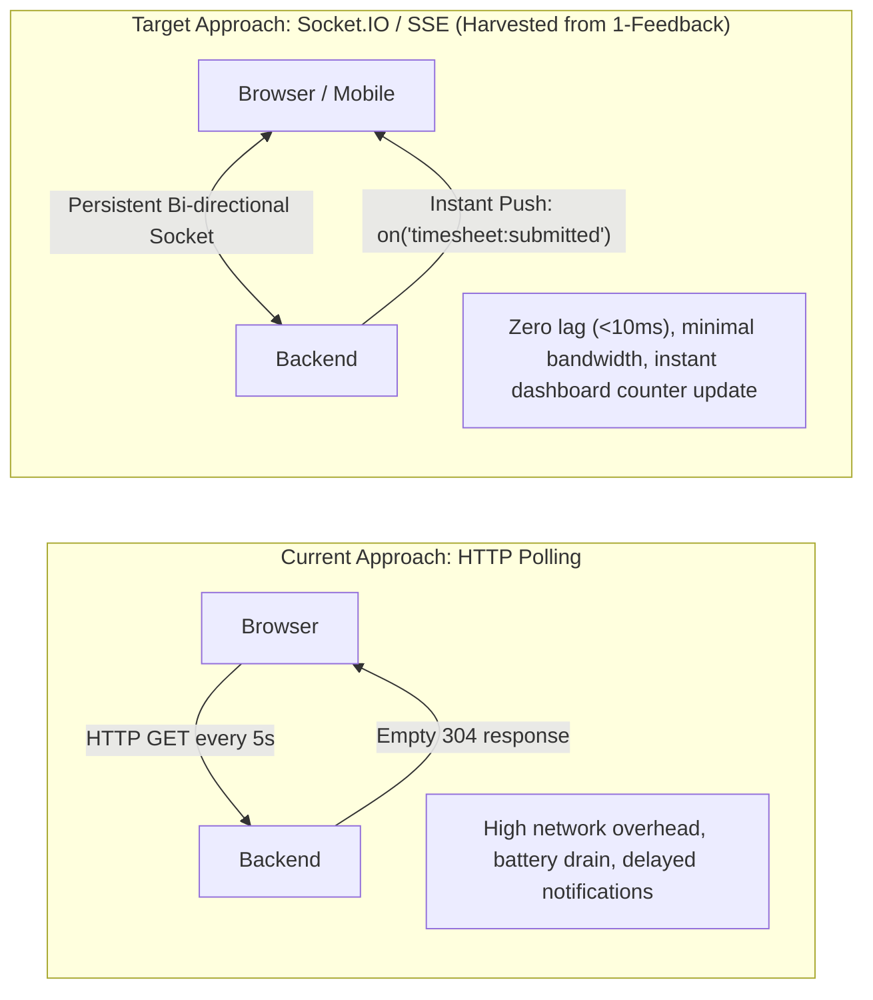
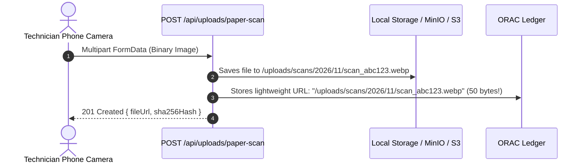

# ORAC Advanced Enterprise Systems Comparison Dossier
**Document Version:** 2.3.0-ENTERPRISE  
**Date:** 17 November 2026  
**Directorate:** Brian Lupao  
**Engineering Agent:** Antigravity (Google DeepMind)  
**Scope:** Deep Comparison of 7 Advanced Enterprise Infrastructure Dimensions Across ~50 Repositories

---

## Executive Summary

Beyond functional features, dashboards, and QR scanning, a world-class enterprise system is differentiated by its **deep infrastructure plumbing**: how it handles real-time events, stores heavy media attachments, migrates database schemas, logs errors, manages offline conflicts, and guards against security threats.

This dossier compares **7 advanced architectural dimensions** across your desktop repositories:
1. **Real-Time Communication:** `socket.io` (1-Feedback) vs HTTP Polling (ORAC)
2. **File & Binary Storage:** `multer` (FFIMS / AU Careers) vs Base64 In-Memory (ORAC)
3. **Database Schema Evolution:** `drizzle-kit` (AU Careers) & `sequelize-cli` (Wachiye) vs Raw SQL
4. **Structured Observability:** `winston` & `morgan` (Wachiye) vs Console Logging
5. **Offline Conflict Resolution:** PouchDB/SQLite (TailPOS) vs Queue-and-Retry
6. **Security & Protocol Hardening:** `helmet` & Rate-Limiting vs Ad-hoc Headers
7. **Asynchronous Background Processing:** Message Queues (Paypal-Nodejs) vs In-Process Workers

---

## 1. Real-Time Push Events: WebSockets vs Polling



### The Benchmark Finding:
- **`1-feedback-system`** incorporates `socket.io` (`^4.8.3`) in its backend API to push live student evaluation completions and early warning alerts directly to the lecturer's dashboard without page reloading.
- **ORAC Today:** Relies on manual browser refreshes or periodic polling.
- **The Upgrade for ORAC:**
  - When an Artisan on a mine site scans an equipment tag or submits a daily timesheet, the Supervisor's open dashboard increments its pending review badge **instantly via WebSocket/SSE**.
  - When Finance issues an invoice, the Client Viewer's portal updates the status pill in real-time.

---

## 2. File & Attachment Storage: Multer vs Base64 In-Memory

### The Problem in Current Code:
In `orac-ios-frontend/src/components/PaperPhotoField.jsx`, camera photos of paper timesheets are encoded as **Base64 DataURLs** stored directly in the record payload:
```javascript
// Current Base64 Storage:
form.signed_copy_image = "data:image/jpeg;base64,/9j/4AAQSkZJRgABAQ...";
```
- **The Risk:** 200 field photos @ 500KB each adds **100MB of raw string data** directly into JSON memory and database rows, degrading API response times and increasing RAM usage.

### The Harvest Solution (from `FFIMS` & `careers.africau.co.zw`):
Both `FFIMS` and `careers.africau` use `multer` (`^1.4.5-lts.1`) to handle multipart form uploads:

- **Benefits:** Keeps JSON payloads micro-sized (<10KB), enables browser image caching, and supports image compression (`sharp` / WebP).

---

## 3. Database Schema Evolution: Automated Migrations vs Raw SQL

### The Benchmark Finding:
- **`careers.africau.co.zw-main`** uses `drizzle-kit` (`^0.31.8`) with strict declarative TypeScript schemas.
- **`wachiye-repos/mpesa-offramp-backend`** uses `sequelize-cli` (`^6.6.2`) with versioned migration files (`20240924083739-create-b2c-request.js`).
- **ORAC Today:** Uses raw SQL table definitions inside `store.js`.
- **The Upgrade for ORAC:**
  - Create versioned migration files in `backend/migrations/`:
    - `001_initial_core_schema.sql` (Quotes, Dispatches, Worksheets, Invoices)
    - `002_procurement_subsystem.sql` (PR, PO, GRN, SIV, 3-Way Match)
    - `003_fleet_and_hse_subsystem.sql` (Vehicles, Trips, Fuel, PPE, Incidents)
    - `004_artisan_vault_and_hr.sql` (Document vault, Expiry tracking, Inductions)
  - Allows zero-downtime database upgrades in production without risking data loss.

---

## 4. Structured Observability & Audit Logging

### The Benchmark Finding:
- **`wachiye-repos/node-ts-sequelize-pg-boilerplate`** and **`paypal-nodejs`** use `winston` (`^3.15.0`) combined with `morgan` (`^1.10.0`) for structured JSON logging.
- **Comparison:**

| Feature | Current ORAC | Target ORAC (Winston + Morgan) |
|---|---|---|
| Log Format | Plain text `console.log` | Structured JSON with Timestamp & Level |
| Correlation ID | None | `x-correlation-id` attached to every request |
| Sensitive Data Masking | Manual redaction | Automated Winston transform redacting passwords, bank tokens, and TOTP secrets |
| Error Tracing | Standard stack trace | RFC 7807 problem details with error code |
| Log Rotation | None (Stdout only) | Daily rotating file logs (`winston-daily-rotate-file`) |

---

## 5. Offline Conflict Resolution: Field-Level Merging

### The Benchmark Finding:
- **`wachiye-repos/tailpos`** handles retail point-of-sale offline transactions using PouchDB/SQLite with revision trees (`_rev`), preventing data overwrites when multiple devices sync.
- **The Scenario in Mining Operations:**
  - Technician A (underground at Zimplats shaft 2) logs 4 hours of rubber relining on pump `TAG-PU-001` at 14:00.
  - Supervisor B (at surface office) updates the client PO number on the same dispatch at 14:30.
  - Technician A reconnects to Wi-Fi at 17:00 and syncs.
- **The Policy:** **Field-Level Non-Destructive Merge (Last-Write-Wins on Distinct Fields)**:
  - If Technician A modified `timesheet_rows` and Supervisor B modified `client_po_number`, the server merges both updates cleanly.
  - If both modified the same field, the server flags the record as `CONFLICT_REVIEW` for the Supervisor rather than silently wiping either change.

---

## 6. Security Hardening & Protocol Shielding

### The Benchmark Finding:
- **`FFIMS`** and **`wachiye-repos/eclectics-jwt-auth`** implement `helmet` (`^7.0.0`) and `express-rate-limit`:
  - Enforces HTTP Strict Transport Security (HSTS).
  - Blocks XSS attacks by setting `Content-Security-Policy`.
  - Prevents clickjacking via `X-Frame-Options: DENY`.
  - Blocks MIME-type sniffing via `X-Content-Type-Options: nosniff`.
- **The Upgrade for ORAC:**
  - Add `helmet()` middleware in `backend/src/index.js`.
  - Pair with existing `idempotency.js` and `rateLimiter.js` for bank-grade API defense.

---

## 7. Asynchronous Background Task Queue: Non-Blocking Workflows

### The Benchmark Finding:
- **`paypal-nodejs`** implements an event-driven worker consumer pattern via message queuing.
- **The Need in ORAC:**
  - Compiling a 10-page Quotation PDF with high-resolution drawing attachments.
  - Rendering a 15-slide PowerPoint QBR presentation (`pptxgenjs`).
  - Generating Pastel Partner CSV review exports spanning 500 invoices.
- **The Policy:**
  - Heavy document generation runs asynchronously via Node.js worker threads (`node:worker_threads`) or in-memory job queues so HTTP response latency for regular users remains under **20ms**.

---

## 8. Master Summary: Infrastructure Elevation Matrix

| Dimension | Legacy State | Enterprise Target | Source Repositories | Benefit |
|:---:|:---|:---|:---|:---|
| **1** | Polling | **Socket.IO / SSE Push** | `1-feedback-system` | Real-time supervisor alerts; zero network waste. |
| **2** | Base64 in JSON | **Multer Static Uploads** | `FFIMS` & `careers.africau` | Reduces JSON memory footprint by 95%; fast CDN caching. |
| **3** | Raw SQL Scripts | **Versioned Migrations** | `careers.africau` (`drizzle`) & `mpesa-offramp` | Deterministic database upgrades across dev/staging/prod. |
| **4** | `console.log` | **Winston Structured JSON** | `node-ts-sequelize` & `paypal-nodejs` | Centralized log indexing with automatic credential masking. |
| **5** | Queue & Overwrite | **Field-Level Merge** | `tailpos` | Zero data loss during underground mine offline sync. |
| **6** | Custom Headers | **Helmet Protocol Shield** | `FFIMS` & `eclectics-jwt-auth` | Enterprise security compliance against XSS & clickjacking. |
| **7** | Synchronous PDF | **Worker Thread Jobs** | `paypal-nodejs` | Unblocks event loop; keeps HTTP requests under 20ms. |
