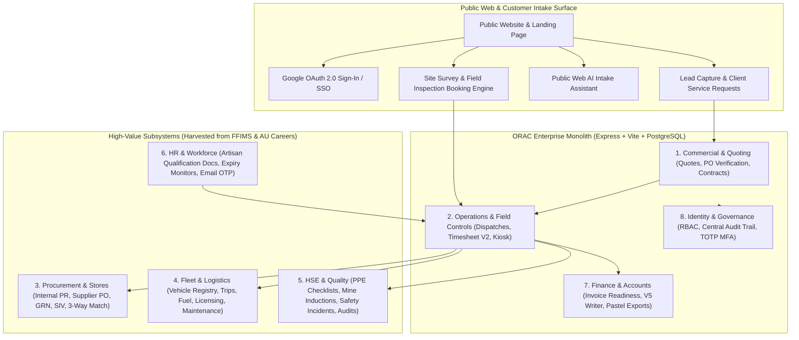

# ORAC World-Class Industrial Platform: Expanded Architecture & Ecosystem Master Plan
**Date:** 2026-11-16  
**System Owner:** Brian Lupao  
**Engineering Directorate:** Antigravity  
**Vision:** Establish ORAC as a premier, world-class Industrial Service Management & Field Operations ERP, unifying Commercial, Operations, Supply Chain, Fleet, Safety, HR, Public Customer Intake, and AI Automation.

---

## 1. Expanded Ecosystem Architecture

ORAC expands from an internal operations back-office into a full **360-degree industrial platform**:

---

## 2. Key Pillars of the Enhanced Platform

### A. Public Website, Google OAuth & Customer Experience
1. **Public Intake & Marketing Surface:**
   - Seamless client-facing portal for industrial plant managers, mines, and engineering contractors.
   - Public service request forms converting directly into `leads` and commercial opportunities.
2. **Google OAuth 2.0 & One-Click Sign-In:**
   - Allow prospective clients and external engineers to sign in with corporate Google accounts (`@zimplats.com`, `@mimosa.co.zw`, etc.).
   - Automatic registration into `access_requests` or client portal view with zero friction.
   - Channel for push and email notifications regarding quotation approvals, survey bookings, and job progress.
3. **Public Web AI Assistant:**
   - Intelligent interactive assistant on the public site to guide clients through service selections (Rubber lining, ceramic tiling, conveyor maintenance, plant wear solutions).
   - Generates preliminary scope recommendations and hands off clean structured data to the Sales Desk.

### B. Site Survey & Inspection Booking Engine (Integration Folder)
1. **Interactive Field Survey Scheduling:**
   - Harvested from `FFIMS/workflow-submodule` and `EventsandBooking` engine.
   - Clients book on-site measurement, plant inspections, or wear assessments directly from the portal.
   - Auto-dispatches a pre-quote inspection card to available field estimators.
2. **Survey-to-Quotation Pipeline:**
   - Survey findings, equipment dimensions, and plant photographs feed directly into `quoteController.js` for instant, accurate pricing.

### C. Enterprise Subsystems (Harvested from Local Repositories)
1. **Supply Chain & Stores (from FFIMS):**
   - Full requisition pipeline: Internal PR $\rightarrow$ Supplier PO $\rightarrow$ GRN $\rightarrow$ Store Issue Voucher.
   - Prevents stock leakage, enforces 3-way matching on vendor invoices.
2. **Fleet & Telematics (from FFIMS):**
   - Complete vehicle fleet tracking, fuel consumption monitoring, vehicle-to-dispatch allocation, driver license expiry reminders.
3. **HSE & Site Safety (from FFIMS + Fault Ticketing):**
   - Mandatory PPE allocation before dispatch, mine site compliance certificates, incident/hazard reporting, equipment maintenance tickets.
4. **HR & Artisan Certification (from AU Careers Platform):**
   - Technician qualification vault (journeyman cards, trade certificates, blasting/rigging licenses).
   - Automated 30/60/90-day expiry monitors in pre-month-end payroll checks.
   - Real transactional Email OTP via SMTP.

---

## 3. Master Principles: World-Class Innovation + Zero Breakage

1. **Keep the Core Rock-Solid:**
   - All 2,540 existing automated tests must remain green at all times.
   - Flat controller organization preserved to ensure zero broken imports or build regressions.
2. **Single Relational Thread:**
   - Every survey, vehicle trip, procurement order, and safety sign-off ties back to the central `quote_id`, `dispatch_card_id`, and `audit_log`.
3. **Proactive Feature Synergy:**
   - Whenever an external feature is reviewed, we extract every capability that adds strength to ORAC's commercial dominance.

---

## 4. Repository Ingestion Readiness

The system is primed to ingest and analyze any additional repository folders provided by Brian. Each incoming folder will be cataloged, mapped against our capabilities, and distilled into high-value production code.
