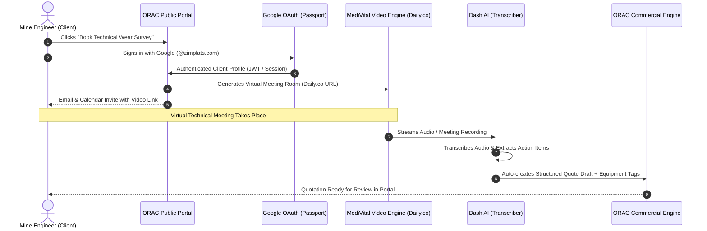
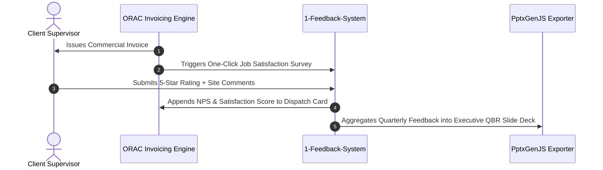

# Master Technical Harvest & Alignment Analysis: Brian Lupao Desktop Repositories
**Date:** 2026-11-16  
**System Owner:** Brian Lupao  
**Engineering Directorate:** Antigravity  
**Goal:** Deeply analyze Brian's personal projects and map their capabilities to achieve 100% full-functionality across the ORAC Industrial ERP ecosystem.

---

## 1. Catalog of Scanned Projects & Key Technologies

We have directly scanned and inspected the 19 project directories on your Desktop. Here is the technical inventory:

| Repository / Project | Tech Stack | Primary Capabilities & Crown Jewels | ORAC Alignment & Enhancement |
| :--- | :--- | :--- | :--- |
| **`MediVital`** (`medivital-hms`) | Node.js, Express, Daily.co (`@daily-co/daily-js`), Anthropic SDK, Twilio, Stripe, Socket.IO, Redux Toolkit, Playwright | • WebRTC Video Consultation Rooms (`videoService.js`, `video.route.js`) • Real-time appointment booking (`appointment.controller.js`) • AI clinical note extraction & transcription | **Virtual Site Survey Meetings & AI Transcription:** Clients book technical briefings; meeting launches inside ORAC; AI summarizes scope & creates quotation line items. |
| **`brian-lupao-portfolio`** | Node.js, Express, Passport.js, `passport-google-oauth20`, Puppeteer, Docx | • Google OAuth 2.0 Sign-In Strategy (`server/config/passport.js`) • Frontend OAuth component (`OAuth.jsx`, `AuthContext.jsx`) • Word `.docx` & PDF report generators | **Public Portal Google SSO:** One-click Google sign-in for mining managers (`@zimplats.com`, `@mimosa.co.zw`), client notifications, and dynamic `.docx` client inspection reports. |
| **`Dash AI`** (`dash-ai`, `DashAI`, `lecturepulse`) | Python (FastAPI), Anthropic / OpenAI LLM prompts, Pydantic validators, React | • Real-time audio transcription pipeline • Structured JSON minute-taking & prompt engineering • Live engagement/attention analytics | **AI Meeting Minutes Transcriber:** Automatically listens to client meetings, transcribes audio, extracts equipment wear tags, action items, and quotation scope. |
| **`1-feedback-system`** & **`feedback`** (`comrades`) | Node.js, Express, Socket.IO, Google Cloud Translate, SendGrid, Fuzzball, PptxGenJS | • 360-degree feedback collection & rating surveys • Multi-language real-time translation • Fuzzy string matching (`fuzzball`) • Automated PowerPoint presentation generation | **Post-Job Client Feedback & NPS:** After invoice settlement, client rates service quality; low ratings trigger supervisor review alerts; exports quarterly QBR decks via `pptxgenjs`. |
| **`aquantel`** | Node.js, TypeScript, Docker, Firmware / Hardware telemetry, MongoDB | • Industrial telemetry & IoT sensor monitoring • Flow, pressure, and tank sensor logging • Hardware device event listeners | **Equipment Tag IoT Telemetry:** Connects physical wear sensors, temperature probes, and pump vibration data directly to ORAC's `equipment_tags`. |
| **`employee-hiring-system`** | Node.js, React, MongoDB, Express | • Candidate job application tracking • Interview stage pipelines • Resume evaluation & HR screening | **Technician Recruitment:** Complete artisan hiring funnel before onboarding into ORAC's field rosters. |
| **`AcaNexus` / `PersonalSystem` / `journey_hub`** | Python, React, SQLite (`attachpro.db`, `acajournal.db`), Agent prompts | • Workplace logbooks & task verification • Multi-agent background handoffs • Activity milestone tracking | **Technician Apprenticeship & Trade Test Tracking:** Formal logbook verification for junior technicians working toward journeyman certification. |
| **`mobile-companion-app`** & **`au-lecturepulse-mobile`** | React Native, Expo | • Mobile offline storage • Push notifications & device hardware integration | **Mobile Field Companion:** Native mobile app for technicians on mining sites with offline worksheet sync. |

---

## 2. End-to-End Implementation Blueprint: The "Full Functionality" Standard

You set the standard: *"if it's booking a video appointment meeting, the whole process up to inviting an AI to transcribe minutes must work."*

Here is how these harvested components integrate into a continuous, working operational thread:

### Flow 1: Public Client Intake $\rightarrow$ Google OAuth $\rightarrow$ Video Survey $\rightarrow$ AI Minutes

### Flow 2: Completed Job $\rightarrow$ Feedback Loop $\rightarrow$ Executive Presentation

---

## 3. High-Value Capabilities Harvested from Your Repositories

1. **Daily.co WebRTC Video Calling (`MediVital/api/services/videoService.js`):**
   - Instant token-based virtual meeting rooms embedded directly in the web portal without external Zoom/Teams dependencies.
2. **AI Clinical/Minutes Transcription (`MediVital` + `Dash AI`):**
   - Uses Anthropic / OpenAI to parse conversation transcripts into structured JSON (Attendees, Action Items, Scope, Pricing Constraints).
3. **Google OAuth 2.0 (`brian-lupao-portfolio/server/config/passport.js`):**
   - Clean Passport.js strategy handling corporate Google single sign-on, profile hydration, and session serialization.
4. **Industrial IoT Telemetry (`aquantel`):**
   - Sensor data ingestion routines for predictive maintenance on heavy industrial plant equipment.
5. **Automated Presentation Deck Generator (`1-feedback-system/pptxgenjs`):**
   - One-click export of operational health reports into client-ready PowerPoint presentations for mining executives.

---

## 4. Preservation of Stability & Governance

* **Core Engine Safety:** All existing 2,540 automated tests remain the non-negotiable benchmark.
* **Modular Integration:** New capabilities are plugged in as clean, decoupled service adapters (`src/services/videoService.js`, `src/services/googleAuth.js`, `src/services/meetingAiService.js`).
* **Zero Dependency Bloat:** Only production-proven dependencies with clean security audits are introduced into ORAC's core package.
