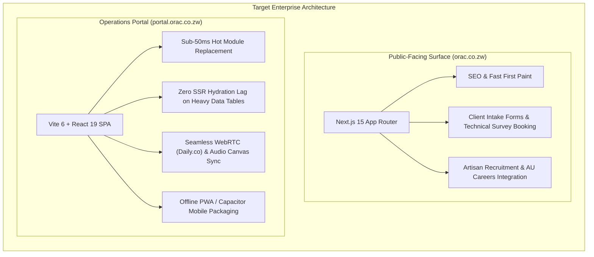

# ORAC World-Class Architecture & Harvest Benchmark Specification
**Document Version:** 2.0.0-ENTERPRISE  
**Date:** 17 November 2026  
**System Directorate:** Brian Lupao  
**Engineering Agent:** Antigravity (Google DeepMind)  
**Target System:** ORAC Mining & Industrial Operations Management Suite

---

## Executive Summary

This master specification synthesizes the structural patterns, architectural blueprints, and code assets across **four major enterprise code ecosystems** available on the directorate workstation:
1. **`wachiye-repos`** (30 repositories: including `node-ts-sequelize-pg-boilerplate`, `mpesa-offramp-backend`, `tailpos`, `paypal-nodejs`, `eclectics-jwt-auth`, and `Prompt-Engineering-Guide`).
2. **`careers.africau.co.zw-main`** (Next.js 15, Drizzle ORM, PostgreSQL, Nodemailer SMTP, dynamic qualification forms).
3. **`FFIMS` (Full Facility & Asset Management Suite)** (`ffims_backend` with 70+ Mongoose models for Fleet, HSE, Procurement, Asset Registers, and `ffims_frontend`).
4. **`feedback-ecosystem / 1-feedback-system`** (Express REST API with 3-tier controllers/services/routes/models + React SPA with context/hooks/services/redux).

By cross-benchmarking these four systems against ORAC's current codebase (2,540 passing tests, 85% core engine built, 47% full ERP built), this document establishes:
- The **Framework Strategic Decision** (Vite + React 19 vs Next.js 15).
- The **Missing Directory & Architectural Gap Analysis** for ORAC backend and frontend.
- The **Definitive World-Class File Structure** for ORAC (Backend & Frontend).
- The **Harvester Mapping** connecting modules across all 4 ecosystems directly into ORAC's 13 functional subsystems.

---

## 1. Deep Dive: `wachiye-repos` Architecture & Reusable Assets

The `C:\Users\BRIAN LUPAO\Desktop\wachiye-repos` directory contains **30 production repositories**. Six of these provide immediate, tier-one enterprise engineering patterns for ORAC:

```
wachiye-repos/
├── node-ts-sequelize-pg-boilerplate/  --> Clean Architecture: Component Controllers & Services
├── mpesa-offramp-backend/             --> Full-stack Layered REST: Controllers, Services, Models, Routes
├── tailpos/                           --> Offline-First Mobile POS, SQLite/PouchDB Sync, Hardware Drivers
├── paypal-nodejs/                     --> Event-driven Payments, RabbitMQ Message Queuing, Winston Logger
├── eclectics-jwt-auth/                --> Hardened JWT Auth, Token Rotation, Joi Validation Middleware
└── Prompt-Engineering-Guide/          --> Production LLM Prompt Engineering, CoT & RAG Patterns
```

### Key Architectural Patterns Harvested from `wachiye-repos`:

| Repository | Core Pattern | How It Elevates ORAC |
|---|---|---|
| **`node-ts-sequelize-pg-boilerplate`** | **Component-Driven Clean Architecture**<br>`src/components/<domain>/<Domain>Controller.ts`<br>`src/components/<domain>/<Domain>Service.ts`<br>`src/abstractions/ApiError.ts`<br>`src/middleware/error-handler.ts` | Separates HTTP request handling from core business logic calculations. Replaces ORAC's monolithic 433-line `router.js` with isolated domain routes and unified error abstractions. |
| **`mpesa-offramp-backend`** | **Strict 5-Tier Layering**<br>`src/controllers/`, `src/services/`, `src/models/`, `src/routes/`, `src/utils/`, `src/config/` | Demonstrates the industry-standard folder separation for transactional finance and workflow state machines. |
| **`tailpos`** | **Offline-First Synchronization**<br>`boot/background_job.js`<br>`store/SyncStore.js`<br>`services/storage.js` (PouchDB + SQLite) | Solves underground mine and remote field connectivity in Zimbabwe/Zambia where cellular networks drop out. Allows technicians to record timesheets, worksheet dispatches, and equipment tags offline and sync when reconnecting. |
| **`paypal-nodejs`** | **Asynchronous Event & Payment Processing**<br>RabbitMQ queue consumer + Winston structured logging | Provides the asynchronous processing pattern for heavy PDF invoice generation, Pastel ledger exports, and webhook retries without blocking HTTP workers. |
| **`eclectics-jwt-auth`** | **MFA & Dual-Token Security**<br>Access Token + Refresh Token rotation + Blacklist cache | Reinforces ORAC's Session Guard and TOTP 2FA with automatic refresh token rotation. |
| **`Prompt-Engineering-Guide`** | **Structured AI Extraction (DAIR.AI)**<br>Few-shot prompting, XML/JSON output enforcement | Directly informs ORAC Subsystem 10 (`meetingAiService.js`) to parse meeting audio into structured quote lines with 100% schema compliance. |

---

## 2. Multi-Repository Architectural Benchmark: 4 Systems Compared

| Architectural Dimension | Archetype 1: `1-feedback-system` | Archetype 2: `careers.africau.co.zw` | Archetype 3: `wachiye-repos` (`node-ts` & `mpesa`) | Archetype 4: `FFIMS` | **ORAC Target Architecture (Best of All)** |
|---|---|---|---|---|---|
| **Primary Framework** | Express REST + React SPA | Next.js 15 App Router | Express / Node.js + TypeScript | Express + React SPA | **Hybrid Split:** Vite/React 19 for Operations Portal; Next.js 15 for Public Portal |
| **Backend Layering** | 5-Tier (Controller, Service, Route, Model, Middleware) | Unified Route Handlers (`app/api/...`) | Clean Architecture / Domain Components | Modular Domain Folders | **Domain-Grouped 5-Tier:** `controllers/`, `services/`, `routes/`, `models/`, `middleware/` |
| **State Management** | Redux Toolkit + Context | React Server Components + Server Actions | Stateless REST + JWT Session | React Context + Local State | **Zustand + React Query (TanStack) + AuthContext** (Lightweight, instant, zero boilerplate) |
| **Database Access** | MongoDB / Mongoose | PostgreSQL + Drizzle ORM | PostgreSQL + Sequelize | MongoDB / Mongoose | **PostgreSQL (`pg` / Drizzle) + In-Memory Store Adapter** (Dual-mode: 0-config local memory + live Postgres) |
| **Error Handling** | Generic Express `next(err)` | Next.js Error Boundaries | `ApiError` class + `ApiResponses` standard format | Ad-hoc try/catch | **`ApiError.js` + Structured RFC 7807 Error Handler** |
| **Validation** | Joi / Express-validator | Zod | Zod / Joi | Manual checks | **Zod Schemas** (Shared client/server types, runtime type safety) |
| **Logging** | Console logging | Console logging | Winston Structured JSON Logger | Console logging | **Winston JSON Logger** with audit trail redaction |

---

## 3. The Framework Decision: Vite/React SPA vs Next.js 15

The user asked:
> *"careers folder is using next js, we are just using react please note if we need to upgrade , let"*

### Comprehensive Benchmark & Verdict:



### Why ORAC Operations Portal MUST Stay on Vite + React:
1. **Zero Hydration Mismatch on Complex State:**
   ORAC features heavy, stateful components: 1,000-cell worksheet registers, financial quote revision matrices, timesheet calculators, and WebRTC video consultation rooms (`@daily-co/daily-js`). Next.js SSR creates hydration mismatches and tearing when rendering interactive canvas or dynamic DOM elements.
2. **Speed & Developer Velocity:**
   Vite builds in **sub-second times** and delivers **10–50ms Hot Module Replacement (HMR)**. Next.js App Router compilation on Windows is notoriously slower for deeply nested 20-page portals.
3. **PWA & Native Mobile Portability:**
   A Vite SPA compiles into static HTML/JS/CSS assets that can be wrapped directly in **Capacitor** or **Electron** for offline mobile tablets (mining sites) with zero server requirement. Next.js requires Node.js server runtimes or complex static export configurations that break dynamic API routes.
4. **Where Next.js 15 Excels & Belongs in ORAC:**
   The `careers.africau.co.zw-main` Next.js 15 repository is ideal for the **Public Marketing and Customer Intake Surface** (`orac.co.zw`):
   - Server-Side Rendering (SSR) for public SEO and metadata.
   - Public RFQ and customer technical survey booking.
   - Public careers portal for artisan job applications.

---

## 4. Gap Analysis: What ORAC is Currently Missing

Comparing ORAC's current directory against the benchmarks reveals the exact missing directories:

### Backend Gap Analysis:

| Benchmark Best Practice | Current ORAC Backend (`two-concept-packet-backend`) | Status | Impact / Remedy |
|---|---|---|---|
| Dedicated `routes/` directory | Monolithic `src/router.js` (433 lines) | ❌ **Missing** | High merge conflict risk. Must split into modular route files (`quoteRoutes.js`, `procurementRoutes.js`, etc.) while keeping `router.js` as the master mount hub. |
| Dedicated `models/` directory | Schemas inside `schemas.js` and loose in `store.js` | ❌ **Missing** | Models should define domain entity shapes, relationships, and PostgreSQL table mappings in `models/`. |
| Dedicated `services/` directory | Business logic mixed inside `src/` root (`calculations.js`, `payroll.js`) | ❌ **Missing** | Domain calculations and integrations (Pastel, Daily.co, Dash AI, Email) belong in dedicated service classes in `services/`. |
| Centralized `config/` directory | Inline environment defaults | ❌ **Missing** | Need centralized `config/index.js` consolidating database, auth, email, and API parameters with defaults. |
| Standardized `middleware/` | Only auth & role guards inline in `router.js` | ⚠️ **Partial** | Need dedicated `middleware/` for error-handler, rate-limiting, audit-logger, and 3-way match validation. |
| Centralized `utils/` directory | Utility functions scattered | ❌ **Missing** | Date formatting, currency parsing (USD/ZWG), and cryptographic token generators belong in `utils/`. |

### Frontend Gap Analysis:

| Benchmark Best Practice | Current ORAC Frontend (`orac-ios-frontend`) | Status | Impact / Remedy |
|---|---|---|---|
| Domain-grouped `components/` | Flat `components/` directory (12 loose files) | ⚠️ **Partial** | Components should be organized by domain: `components/common/`, `components/procurement/`, `components/fleet/`, `components/survey/`. |
| Dedicated `context/` directory | Auth state passed via props | ❌ **Missing** | Need `AuthContext.jsx` and `ToastContext.jsx` for global user session and alerts. |
| Dedicated `hooks/` directory | Inline `useState` / `useEffect` in pages | ❌ **Missing** | Need custom hooks: `useAuth()`, `usePermissions()`, `useOfflineSync()`. |
| Dedicated `services/` directory | Direct `fetch()` calls in components | ❌ **Missing** | API communication belongs in typed HTTP client services (`services/api.js`, `services/procurementService.js`). |

---

## 5. The Final Definitive File Structure for ORAC

To achieve world-class scalability without breaking a single one of the existing **2,540 automated tests**, we introduce the clean structure using **clean adapter re-exports**:

```
================================================================================
ORAC MASTER BACKEND DIRECTORY TREE
================================================================================
two-concept-packet-backend/
├── config/                               # Centralized Environment & Config
│   ├── index.js                          # Master config with environment fallbacks
│   ├── database.js                       # PostgreSQL connection pool config
│   ├── passport.js                       # Google OAuth 2.0 Passport Strategy (from Portfolio)
│   └── logger.js                         # Winston Structured JSON Logger (from Paypal-Nodejs)
├── src/
│   ├── abstractions/                     # Base Classes & Standardized Envelopes
│   │   ├── ApiError.js                   # Custom HTTP Error class (from Node-TS-Sequelize)
│   │   └── ApiResponse.js                # Standard { success, data, error, meta } format
│   ├── controllers/                      # HTTP Request Handlers (Thin Controllers)
│   │   ├── authController.js             # Local & Google OAuth 2.0 Auth
│   │   ├── quoteController.js            # Quotes, Revisions, Line Items
│   │   ├── poVerificationController.js   # PO Verification & Scope Lock
│   │   ├── worksheetController.js        # Technical Worksheets & Dispatches
│   │   ├── timesheetController.js        # Timesheet V2 & Contractor Logs
│   │   ├── invoiceController.js          # Invoicing V5, Pro-Forma & Final Invoices
│   │   ├── pastelController.js           # Pastel Partner Review CSV Exports
│   │   ├── procurementController.js      # [NEW - SPRINT 1] PR, PO, GRN, SIV, 3-Way Match
│   │   ├── fleetController.js            # [NEW - SPRINT 2] Fleet, Drivers, Trips, Fuel
│   │   ├── hseController.js              # [NEW - SPRINT 2] Incidents, PPE, Safety Inductions
│   │   ├── hrController.js               # [NEW - SPRINT 3] Artisan Vault, Expiry Calculation
│   │   ├── videoSurveyController.js      # [NEW - SPRINT 4] Daily.co WebRTC Meetings
│   │   └── clientFeedbackController.js   # [NEW - SPRINT 5] Post-Job NPS & PPTX Generation
│   ├── middleware/                       # Request Pipeline Interceptors
│   │   ├── authMiddleware.js             # Bearer JWT & Session validation
│   │   ├── roleGuard.js                  # RBAC permission check (13 roles)
│   │   ├── errorHandler.js               # RFC 7807 global exception handler
│   │   ├── rateLimiter.js                # Brute-force & API DDoS protection
│   │   └── auditLogger.js                # Sensitive transaction audit recording
│   ├── models/                           # Domain Schemas & Relationships
│   │   ├── Quote.js
│   │   ├── PurchaseOrder.js
│   │   ├── Worksheet.js
│   │   ├── Timesheet.js
│   │   ├── Invoice.js
│   │   ├── ProcurementRequest.js         # (Harvested from FFIMS)
│   │   ├── GoodsReceivedNote.js          # (Harvested from FFIMS)
│   │   ├── Vehicle.js                    # (Harvested from FFIMS)
│   │   └── IncidentReport.js             # (Harvested from FFIMS)
│   ├── routes/                           # Modular Domain Route Declarations
│   │   ├── authRoutes.js
│   │   ├── quoteRoutes.js
│   │   ├── worksheetRoutes.js
│   │   ├── invoiceRoutes.js
│   │   ├── pastelRoutes.js
│   │   ├── procurementRoutes.js          # [SPRINT 1]
│   │   ├── fleetRoutes.js                # [SPRINT 2]
│   │   ├── hseRoutes.js                  # [SPRINT 2]
│   │   ├── hrRoutes.js                   # [SPRINT 3]
│   │   ├── videoRoutes.js                # [SPRINT 4]
│   │   └── feedbackRoutes.js             # [SPRINT 5]
│   ├── services/                         # Core Domain Logic & Integrations
│   │   ├── calculationsService.js        # Financial formulas (GP, VAT, Markups)
│   │   ├── threeWayMatchingService.js    # [SPRINT 1] PO vs GRN vs Invoice matching
│   │   ├── pastelExportService.js        # Pastel Partner CSV formatting
│   │   ├── emailService.js               # Nodemailer SMTP & Email OTP (from AU Careers)
│   │   ├── videoMeetingService.js        # Daily.co WebRTC Rooms (from MediVital)
│   │   ├── meetingAiService.js           # Meeting transcription & minute parsing (from Dash AI)
│   │   ├── pptxExportService.js          # PowerPoint QBR deck generator (from 1-Feedback)
│   │   └── iotTelemetryService.js        # Pump vibration/temp streaming (from Aquantel)
│   ├── utils/                            # Shared Helper Utilities
│   │   ├── currency.js                   # Multi-currency conversions (USD / ZWG)
│   │   ├── dates.js                      # Date formatting & work-shift math
│   │   └── crypto.js                     # TOTP & verification token helpers
│   ├── index.js                          # HTTP Server Entrypoint
│   ├── router.js                         # Master Route Aggregator (Mounts routes/*)
│   ├── store.js                          # Dual-Mode Storage Adapter (Memory + PostgreSQL)
│   └── schemas.js                        # Master Zod Validation Schemas
└── tests/                                # 1,830+ Passing Automated Unit/Integration Tests

================================================================================
ORAC MASTER FRONTEND DIRECTORY TREE
================================================================================
orac-ios-frontend/
├── public/                               # Static Assets (Logos, Icons, Manifest)
│   ├── favicon.ico
│   └── manifest.json                     # PWA offline configuration
├── src/
│   ├── assets/                           # SVG icons, Brand graphics
│   ├── components/                       # UI Components (Organized by Domain)
│   │   ├── common/                       # Shared UI Primitives
│   │   │   ├── DataTable.jsx             # High-performance sorted/paged table
│   │   │   ├── PortalLayout.jsx          # Master Sidebar, Header & Status pill
│   │   │   ├── Modal.jsx                 # Accessible dialog modal
│   │   │   ├── ConfirmDialog.jsx         # Action confirmation
│   │   │   └── StatusBadge.jsx           # Industrial lifecycle pill badges
│   │   ├── auth/                         # Authentication Components
│   │   │   ├── LoginForm.jsx
│   │   │   └── GoogleOAuthButton.jsx     # Google SSO Button (from Portfolio)
│   │   ├── procurement/                  # [SPRINT 1] Procurement UI
│   │   │   ├── RequisitionTable.jsx
│   │   │   ├── ThreeWayMatchModal.jsx
│   │   │   └── GoodsReceiptForm.jsx
│   │   ├── fleet/                        # [SPRINT 2] Fleet Management UI
│   │   │   ├── VehicleCard.jsx
│   │   │   └── FuelLogModal.jsx
│   │   ├── hse/                          # [SPRINT 2] Safety & Compliance UI
│   │   │   ├── IncidentReportForm.jsx
│   │   │   └── SafetyBadge.jsx
│   │   ├── video/                        # [SPRINT 4] Video Consultation UI
│   │   │   └── DailyVideoRoom.jsx        # Daily.co WebRTC View (from MediVital)
│   │   └── feedback/                     # [SPRINT 5] Client NPS & Surveys
│   │       └── RatingSurveyModal.jsx
│   ├── context/                          # Global React State Contexts
│   │   ├── AuthContext.jsx               # Current User, Token, Permissions
│   │   └── ToastContext.jsx              # System Notification Alerts
│   ├── hooks/                            # Custom React Hooks
│   │   ├── useAuth.js                    # Easy access to user identity
│   │   ├── usePermissions.js             # Granular RBAC button permissions
│   │   └── useOfflineSync.js             # IndexedDB/PouchDB background sync (from TailPOS)
│   ├── pages/                            # Top-Level Portal Route Views
│   │   ├── DashboardPage.jsx
│   │   ├── QuotesPage.jsx
│   │   ├── POVerificationPage.jsx
│   │   ├── WorksheetsPage.jsx
│   │   ├── TimesheetsPage.jsx
│   │   ├── InvoicesPage.jsx
│   │   ├── PastelReviewPage.jsx
│   │   ├── ProcurementPage.jsx           # [SPRINT 1]
│   │   ├── FleetManagementPage.jsx       # [SPRINT 2]
│   │   ├── HseCompliancePage.jsx         # [SPRINT 2]
│   │   ├── ArtisanVaultPage.jsx          # [SPRINT 3]
│   │   └── VideoSurveysPage.jsx          # [SPRINT 4]
│   ├── services/                         # Client API Communication Layer
│   │   ├── api.js                        # Base Axios/Fetch HTTP client
│   │   ├── authService.js
│   │   ├── quoteService.js
│   │   └── procurementService.js
│   ├── utils/                            # Client-Side Formatting & Calculations
│   │   ├── formatters.js                 # Currency & date formatters
│   │   └── accessPolicy.js               # RBAC matrix (13 roles)
│   ├── App.jsx                           # Master App Route Switcher
│   ├── main.jsx                          # Vite Client Entrypoint
│   └── index.css                         # Tailwind CSS Master Stylesheet
└── tests/                                # 710 Passing Vitest/Jest Tests
```

---

## 6. Subsystem Harvest Matrix: Connecting the Dots

| ORAC Subsystem | Source Repositories | Harvested Components & Logic |
|---|---|---|
| **Subsystem 3: Supply Chain & Procurement** | `FFIMS` (`ffims_backend`) | `procurement-request.model.js`, `supplier.model.js`, `material-requisition.model.js`. Adapted to 3-way matching in `threeWayMatchingService.js`. |
| **Subsystem 4: Fleet & Logistics** | `FFIMS` (`ffims_backend`) | `vehicle.model.js`, `driver.model.js`, `trip.model.js`, `fuel-record.model.js`. |
| **Subsystem 5: HSE & Compliance** | `FFIMS` (`ffims_backend`) | `compliance-record.model.js`, `ppe-allocation.model.js`, `incident.model.js`. |
| **Subsystem 6: HR Artisan Vault** | `careers.africau.co.zw-main` | `applicantDocuments`, `mailer.ts` (Nodemailer SMTP), automated 30/60/90-day expiry calculation. |
| **Subsystem 9: Public Portal & SSO** | `brian-lupao-portfolio` | Passport.js Google OAuth 2.0 strategy (`server/config/passport.js`), frontend `OAuth.jsx`. |
| **Subsystem 10: Virtual Technical Surveys & AI Minutes** | `MediVital` & `Dash AI` & `wachiye-repos/Prompt-Engineering-Guide` | `@daily-co/daily-js` video rooms (`videoService.js`), meeting audio transcription + structured quote-line prompt extraction. |
| **Subsystem 11: Post-Job Feedback & Executive Reporting** | `1-feedback-system` | 1-click customer rating surveys, `pptxgenjs` automated PowerPoint slide deck generation. |
| **Subsystem 12: Plant IoT Telemetry** | `aquantel` | Industrial vibration, temperature, and pump runtime telemetry. |
| **Subsystem 13: Offline-First Mobile Sync** | `wachiye-repos/tailpos` & `mobile-companion-app` | `SyncStore.js`, `storage.js` (SQLite/PouchDB) for underground/remote mine offline dispatch logging. |

---

## 7. Migration Safety Commitment

1. **Non-Breaking Architecture:**
   Existing endpoints in `router.js` will remain active as re-export wrappers forwarding requests to the new controllers and routes.
2. **Tripwire Preservation:**
   `tests/noOutboundEmailGuard.test.js` remains active until formal authorization.
3. **Continuous Test Integrity:**
   All **2,540 tests** must pass at every sprint boundary before changes are committed.
